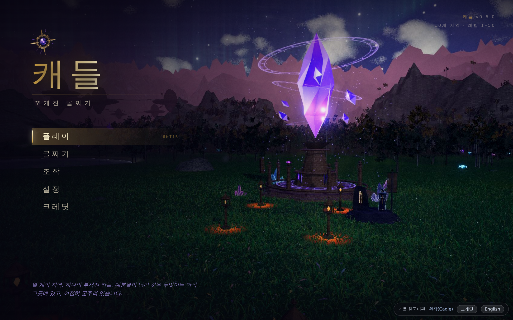
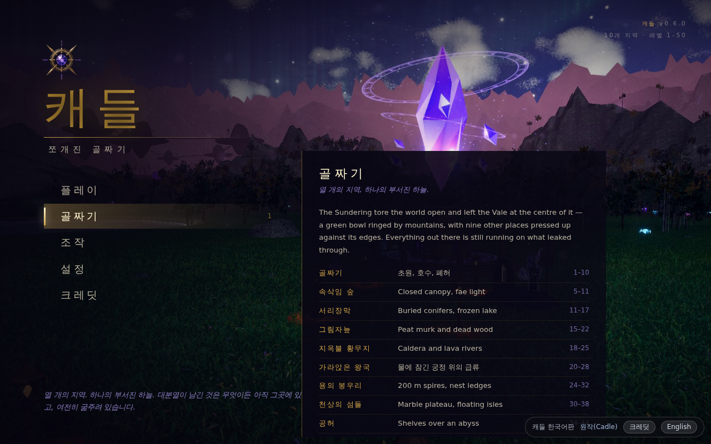
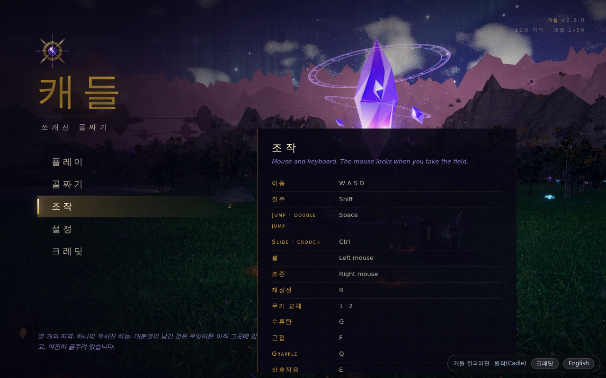
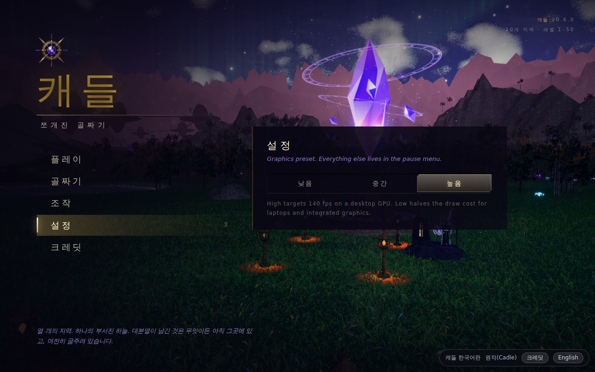
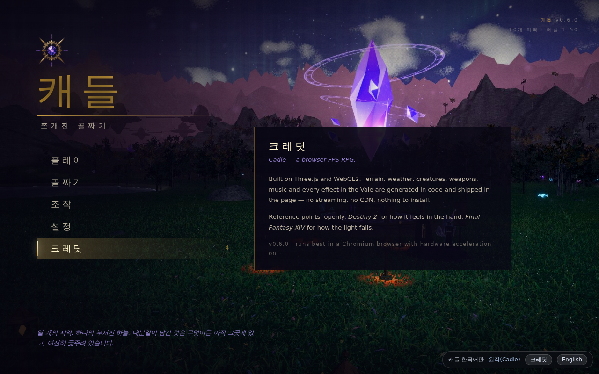
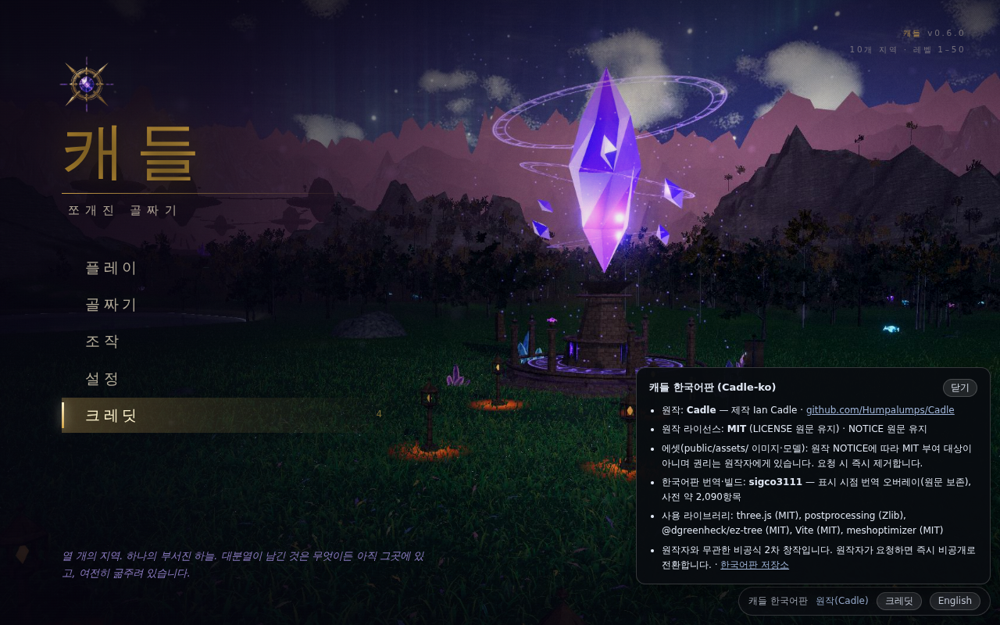
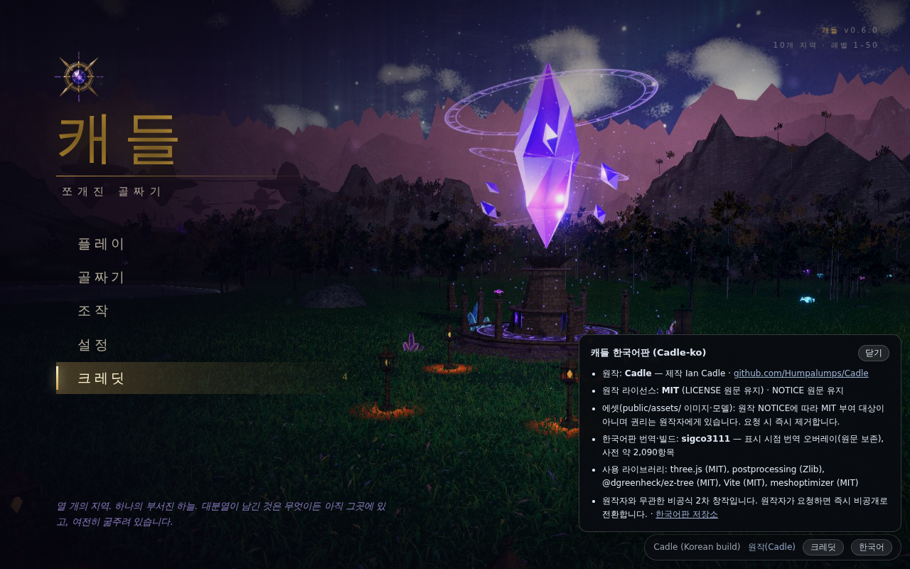
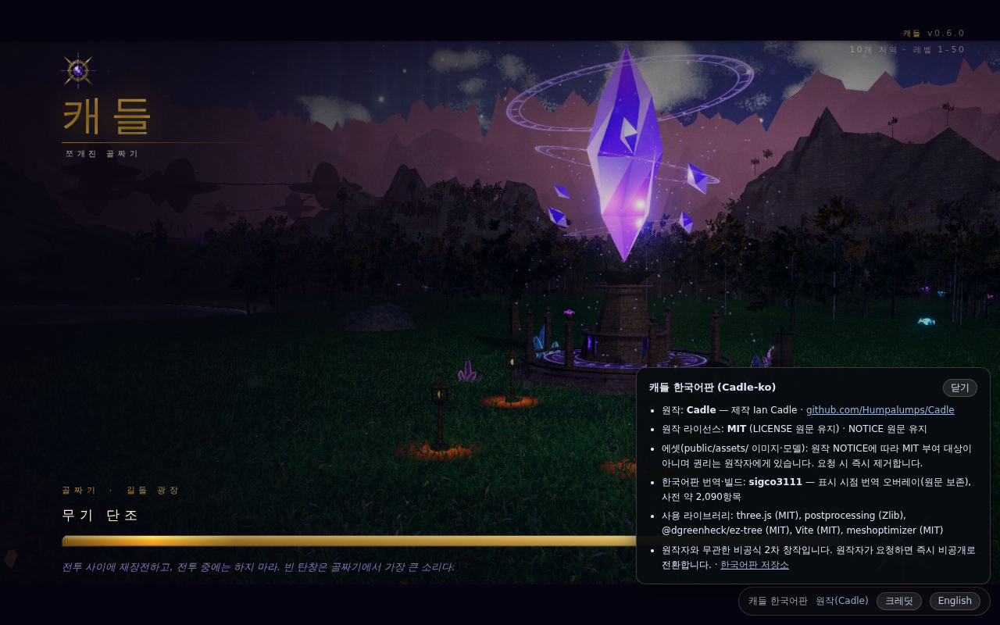
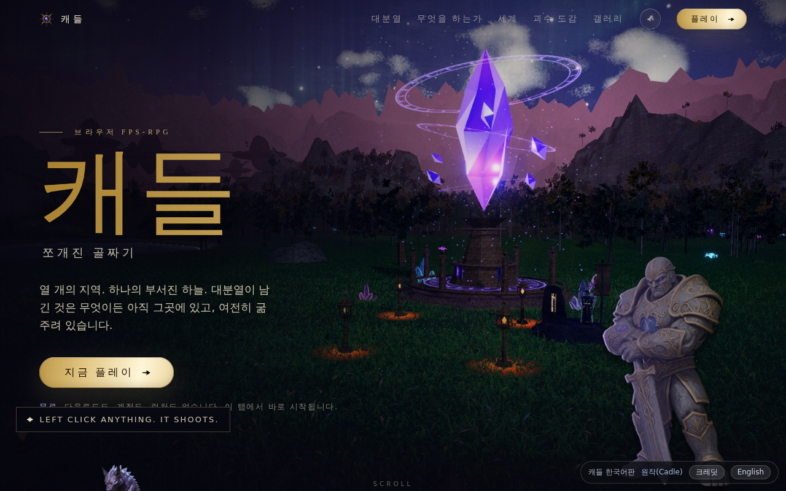

<div align="center">

# Cadle Korean (Cadle-ko)

**Unofficial Korean localisation of *Cadle* — a Destiny-flavoured FPS-RPG that runs in a browser tab**

[▶ Play (Korean)](https://sigco3111.github.io/cadle-ko/play/) · [Original repository](https://github.com/Humpalumps/Cadle) · [Original demo](https://cadle.gg/play/)

</div>

No install, no account, no download. The link above starts the game inside the browser tab.

---

## Screenshots

Captured from the deployed Korean build (https://sigco3111.github.io/cadle-ko/play/).

| Title screen | Regions |
| --- | --- |
|  |  |

| Controls | Settings |
| --- | --- |
|  |  |

| In-game credits (original) | Korean build credits |
| --- | --- |
|  |  |

| English toggle | In game |
| --- | --- |
|  |  |

| Landing page |
| --- |
|  |

---

## The game

*Cadle* is a browser FPS-RPG built with three.js.

- **World** — one continuous 2 km² (2048 × 2048 m) heightfield with ten regions, ringed by a mountain range; nine passes lead out of the central bowl.
- **Quests** — 65, each with its own title, objective, giver dialogue and completion line.
- **Combat** — 25 creature types, per-archetype recoil and ADS, hit markers and damage numbers, momentum-based sprint / slide / double jump.
- **Rendering** — terrain, weather, creatures, weapons, music and effects are all generated in code (no streaming, no CDN).
- **Levels** — 1–50, with recommended ranges per region; every region boundary can be crossed on foot.

The original author describes the target as *Destiny 2*'s moment-to-moment feel with *Final Fantasy XIV*'s light.

## What the Korean build adds

- **All 65 quests** translated — titles, objectives, giver lines, progress and completion text.
- **Items, weapons, armour, creatures, regions, places** — names, descriptions and tooltips.
- **Menus, settings, controls and credits** screens, plus the **landing page** copy.
- **Live Korean / English switch** — the button at the bottom right, remembered per browser.
- **Korean typography** — Korean fonts first, Korean line-breaking.
- **Credits in the game** — the bottom-right bar carries `캐들 한국어판`, a link to the original repo and a `크레딧` button with author, licence, translator and library credits.
- **Nothing else is touched** — game logic and assets are untouched; only displayed text changes, and the original strings are restored when switching to English.

## How the translation works

No game code is modified: translation happens as a **display-time overlay**.

- `src/i18n/overlay.js` observes text nodes and the `title` / `placeholder` / `aria-label` / `alt` attributes, replacing only strings present in the dictionary. Originals are kept in a `WeakMap` and restored when the language is set to English. A `MutationObserver` covers UI rendered later.
- `src/i18n/ko.json` holds the English → Korean dictionary (**about 2,090 entries**) plus regex rules for dynamic strings containing numbers and proper nouns.
- Terminology is fixed in [docs/glossary.md](docs/glossary.md).
- Build: a GitHub Actions runner copies the upstream commit, injects the overlay, runs `npm install` and `vite build --base=/cadle-ko/`, then publishes `docs/`.

## Controls

| Action | Key |
| --- | --- |
| Move | W A S D |
| Sprint | Shift |
| Jump / double jump | Space |
| Slide / crouch | Ctrl |
| Fire / aim | Left / right mouse |
| Reload | R |
| Swap weapon | 1 · 2 |
| Grenade | G |
| Melee | F |
| Grapple | Q |
| Interact | E |
| Map / character / bag | M / C / I |
| Skills / quests | K / J |
| Pause | Esc |

## Running locally

```bash
npm install
npm run dev        # http://127.0.0.1:5173/play/
```

Building the published form:

```bash
npx vite build --base=/cadle-ko/
node tools/wrapup/publish.mjs   # dist -> docs (rewrites root-absolute paths for the Pages sub-path)
```

Regenerating the screenshots (serves `docs/` locally and captures with Playwright):

```bash
npx playwright install chromium
node tools/wrapup/screenshots.mjs   # docs/screenshots/*.png
```

## Credits

- **Original** — *Cadle* by **Ian Cadle** · <https://github.com/Humpalumps/Cadle>
- **Original licence** — **MIT**; the upstream `LICENSE` is kept unchanged.
- **Korean build** — translation and build by **sigco3111** · <https://github.com/sigco3111/cadle-ko>
  - display-time translation overlay (originals preserved) with about 2,090 dictionary entries
- **Libraries (as upstream)** — three.js (MIT) r185, postprocessing (Zlib), @dgreenheck/ez-tree (MIT), meshoptimizer (MIT), Vite (MIT); tooling: sharp (Apache-2.0), Playwright (Apache-2.0).
- **Assets** — the images and models under `public/assets/` are **not** covered by the MIT grant, per the upstream `NOTICE`. They are included unchanged so the game runs; this repository claims no rights in them.

The same credits are available in game through the **크레딧** button.

## Licence and attribution

- Upstream code is **MIT** (Copyright (c) 2026 Ian Cadle); the upstream `LICENSE` and `NOTICE` are kept verbatim.
- What this fork adds (`src/i18n/`, `tools/wrapup/`) is released under the same MIT terms.
- Localisation is based on upstream commit `ea0da62549980816a6a27e08b75808b1f56d70e7`.
- This is an unofficial derivative work, not affiliated with the original author. **On the author's or any rights holder's request the repository is made private and removed immediately** — please open an issue at <https://github.com/sigco3111/cadle-ko/issues>.
- See [NOTICE-ko.md](NOTICE-ko.md) (Korean).

## Changes other than translation

- `play/index.html` and `index.html` load the Korean overlay script.
- After building, root-absolute paths in `docs/` (`/assets/…`, `/play`) are rewritten for `/cadle-ko/` by `tools/wrapup/publish.mjs`.
- A Korean credits bar and credit panel were added in `src/i18n/overlay.js`.
- Development material (`progress/`, `progress.html`, `.claude/`) is excluded from the published build; the upstream `docs/` was moved to `upstream-docs/`.
- This file is the English edition of the notes above; the upstream README is unchanged upstream.

## Verification

| Item | Result |
| --- | --- |
| Pages URL | OK (`/play/` returns 200, title screen loads) |
| Korean text | OK (title, menus, controls, settings, landing copy) |
| English toggle | OK (button restores the original strings) |
| Sub-path asset loading | OK (no root-absolute `/assets/` references in the build output) |
| In-game credits | OK (author, licence, translator and library panel) |
| Screenshots | OK (captured with Playwright, `docs/screenshots/`) |
| In-game 3D play | Captured headless (software rendering); frame rate differs from real hardware |
