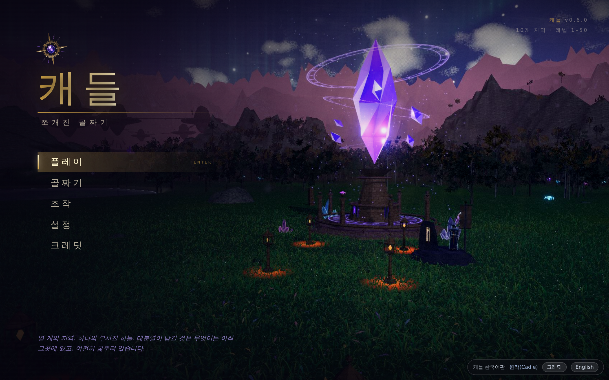
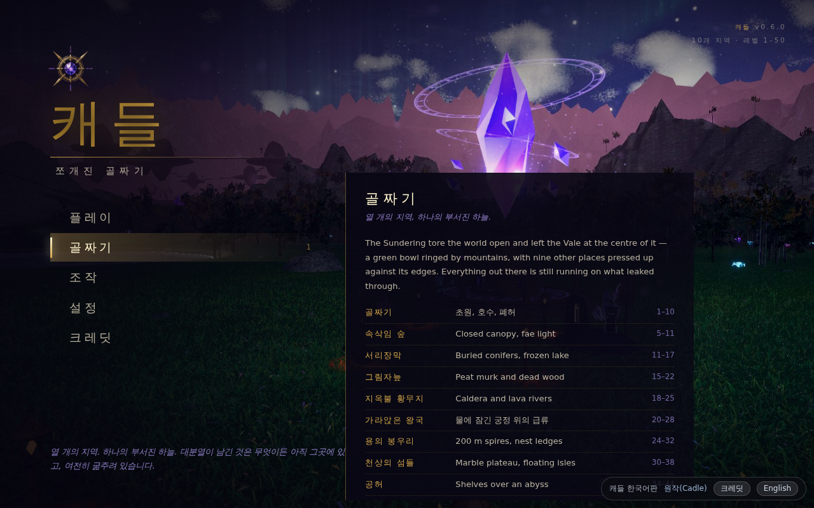
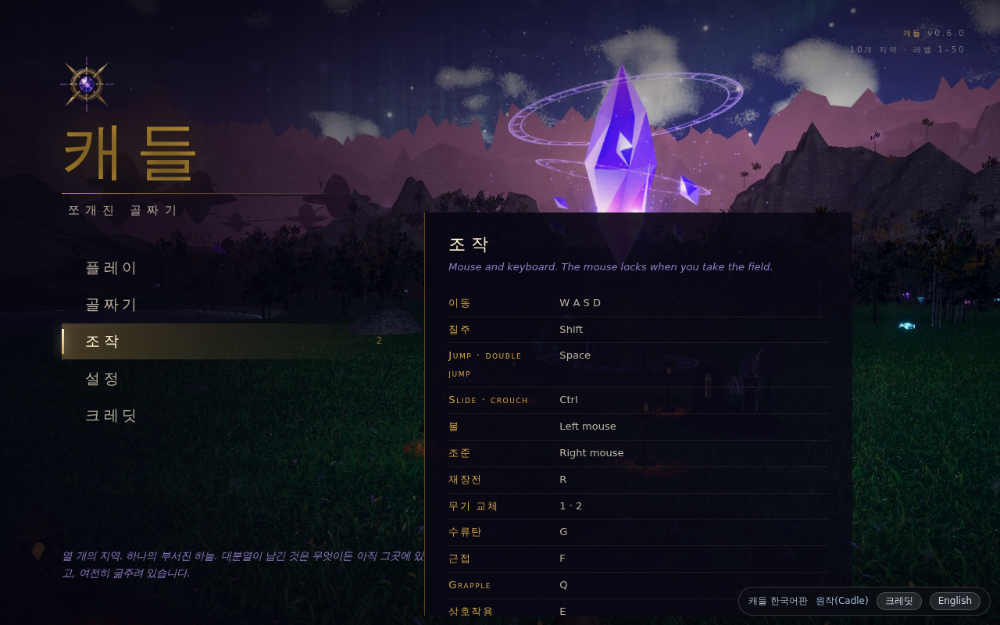
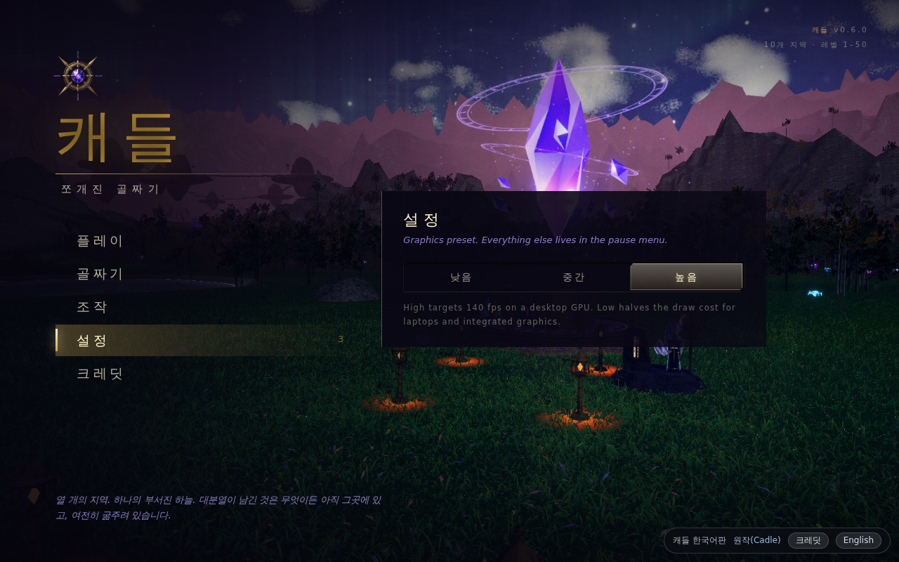
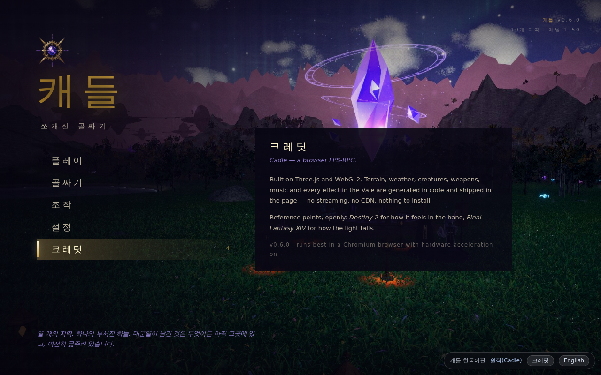
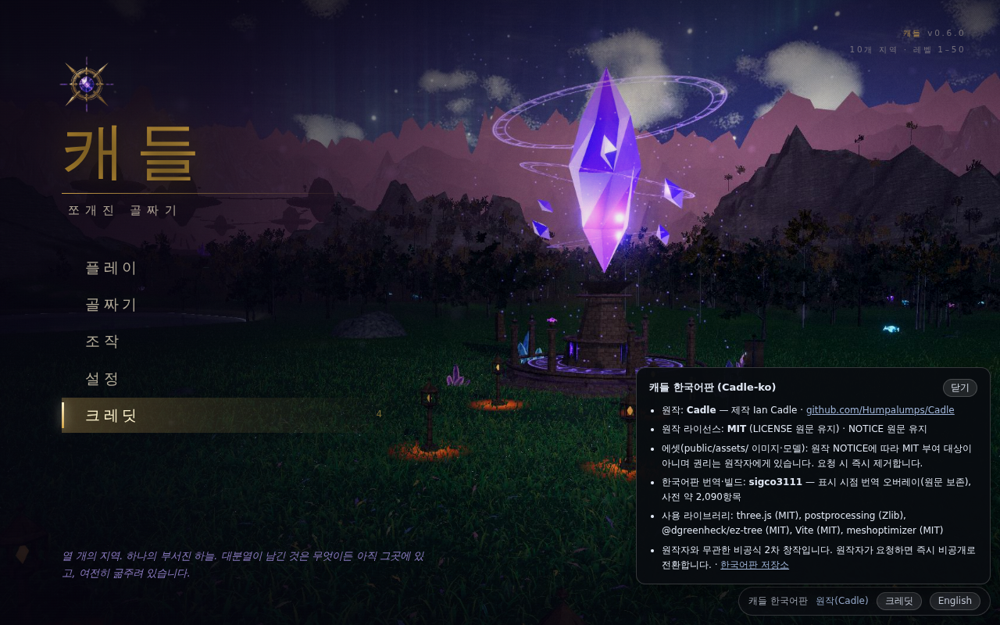
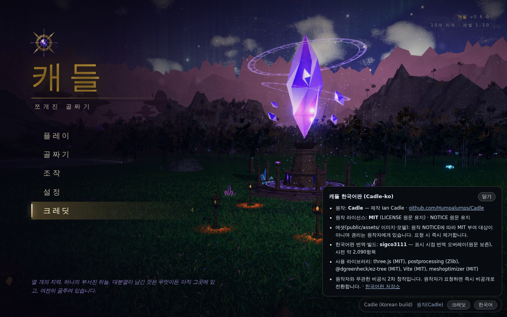
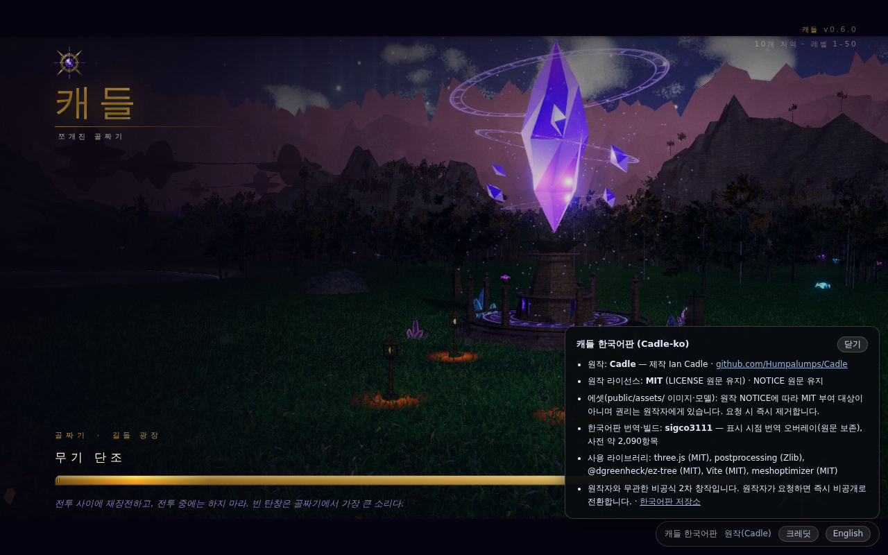
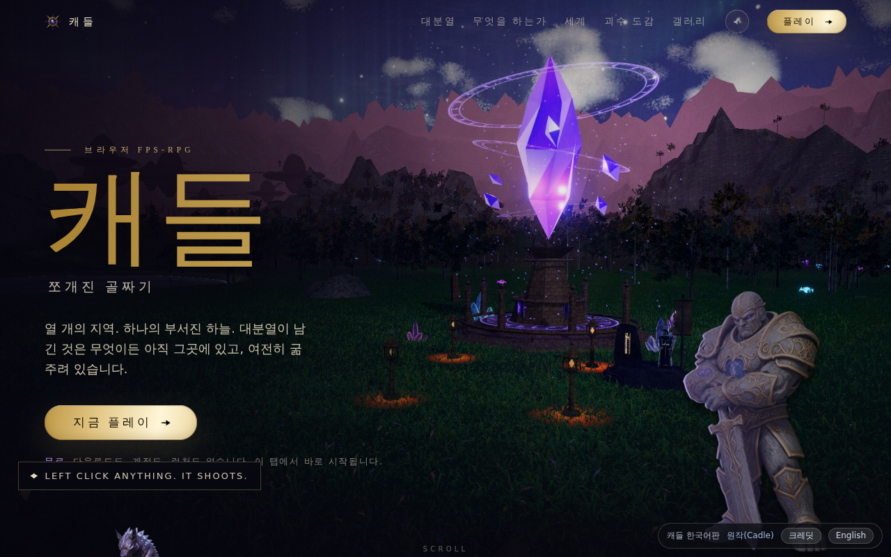

<div align="center">

# 캐들 한국어판 (Cadle-ko)

**비공식 한국어판 — 브라우저에서 바로 켜지는 Destiny 풍 FPS-RPG 「Cadle」의 한국어판**

[▶ 플레이하기](https://sigco3111.github.io/cadle-ko/play/) · [원작 저장소](https://github.com/Humpalumps/Cadle) · [원작 데모](https://cadle.gg/play/)

</div>

설치도, 계정도, 다운로드도 없습니다. 위 링크를 열면 브라우저 탭 안에서 바로 게임이 시작됩니다.

---

## 스크린샷

배포 페이지(https://sigco3111.github.io/cadle-ko/play/)의 한국어 화면을 캡처했습니다.

| 타이틀 화면 | 지역 선택 |
| --- | --- |
|  |  |

| 조작 안내 | 설정 |
| --- | --- |
|  |  |

| 인게임 크레딧(원작) | 한국어판 크레딧 패널 |
| --- | --- |
|  |  |

| English 전환 | 인게임(플레이) |
| --- | --- |
|  |  |

| 랜딩 페이지 |
| --- |
|  |

---

## 게임 소개

「Cadle」은 three.js로 만든 **브라우저 FPS-RPG**입니다.

- **세계**: 2 km²(2048 × 2048 m)의 연속 지형, 10개 지역. 산맥 고리로 둘러싸인 중앙 분지에서 아홉 개의 고개를 넘어 바깥 지역으로 걸어 나갑니다.
- **퀘스트**: 65개. 지역마다 고유의 퀘스트·의뢰 대사·완료 문구가 있습니다.
- **전투**: 25종의 크리처, 아키타입별 반동과 ADS, 히트 마커·데미지 넘버, 슬라이드·더블 점프의 관성 이동.
- **표현**: 지형·날씨·크리처·무기·음악·이펙트가 모두 코드로 생성됩니다(스트리밍·CDN 없음).
- **레벨 범위**: 1–50. 지역별 권장 레벨이 정해져 있고, 지역 경계는 모두 걸어서 넘을 수 있습니다.

원작은 *Destiny 2*의 손맛과 *Final Fantasy XIV*의 빛을 목표로 삼았다고 밝히고 있습니다.

## 한국어판 특징

- **퀘스트 65개 번역**: 제목·목표·의뢰 대사·진행 문구·완료 문구.
- **아이템·무기·방어구·크리처·지역·장소** 이름과 설명, 툴팁 번역.
- **메뉴·설정·조작·크레딧** 화면 문구와 **랜딩 페이지** 소개 문구 번역.
- **한국어/영어 실시간 전환**: 오른쪽 아래 `English / 한국어` 버튼. 선택은 브라우저에 저장되어 다음 방문에도 유지됩니다.
- **한글 표시 최적화**: 한글 글꼴 우선 적용, 한국어 줄바꿈(word-break) 처리.
- **게임 안에서 원작 표기**: 화면 오른쪽 아래에 `캐들 한국어판`·`원작(Cadle)` 링크와 `크레딧` 버튼(원작자·라이선스·번역·라이브러리 표기)이 항상 표시됩니다.
- **원작 보존**: 게임 로직·에셋은 그대로 두고 화면 문구만 바꿉니다. 원문은 메모리에 보관해 두었다가 English로 되돌립니다.

## 번역 방식

게임 코드를 고치지 않고 **표시 시점 번역 오버레이**로 처리합니다.

- `src/i18n/overlay.js` — DOM 텍스트 노드와 `title`/`placeholder`/`aria-label`/`alt` 속성을 관찰해, 사전에 있는 문구만 한국어로 바꿉니다. 원문은 `WeakMap`에 보존하고, 언어를 English로 바꾸면 그대로 복원합니다. `MutationObserver`로 나중에 그려지는 UI도 따라갑니다.
- `src/i18n/ko.json` — 원문 → 한국어 사전 **약 2,090개 항목**과, 숫자·고유명사가 섞인 동적 문구를 위한 정규식 규칙.
- 용어는 [docs/glossary.md](docs/glossary.md)에 고정해 두었습니다(지역명·크리처명·스킬명 등).
- 빌드: GitHub Actions 러너가 원작 커밋을 복사 → 오버레이 주입 → `npm install` → `vite build --base=/cadle-ko/` → `docs/` 게시.

## 조작

| 동작 | 키 |
| --- | --- |
| 이동 | W A S D |
| 질주 | Shift |
| 점프 / 더블 점프 | Space |
| 슬라이드 / 앉기 | Ctrl |
| 사격 / 조준 | 좌클릭 / 우클릭 |
| 재장전 | R |
| 무기 교체 | 1 · 2 |
| 수류탄 | G |
| 근접 공격 | F |
| 갈고리 | Q |
| 상호작용 | E |
| 지도 / 캐릭터 / 가방 | M / C / I |
| 스킬 / 퀘스트 | K / J |
| 일시정지 | Esc |

## 로컬 실행

```bash
npm install
npm run dev        # http://127.0.0.1:5173/play/
```

배포본과 같은 형태로 빌드하려면:

```bash
npx vite build --base=/cadle-ko/
node tools/wrapup/publish.mjs   # dist → docs (Pages 하위 경로 치환 포함)
```

스크린샷을 다시 만들려면(로컬 `docs/`를 정적 서버로 띄워 캡처):

```bash
npx playwright install chromium
node tools/wrapup/screenshots.mjs   # docs/screenshots/*.png
```

## 크레딧

- **원작**: Cadle — 제작 **Ian Cadle** · <https://github.com/Humpalumps/Cadle>
- **원작 라이선스**: **MIT** — 원작 `LICENSE` 원문을 그대로 유지합니다.
- **한국어판**: 번역·빌드 **sigco3111** · <https://github.com/sigco3111/cadle-ko>
  - 표시 시점 번역 오버레이(원문 보존) + 사전 약 2,090항목
- **사용 라이브러리**(원작 그대로): three.js (MIT) r185, postprocessing (Zlib), @dgreenheck/ez-tree (MIT), meshoptimizer (MIT), Vite (MIT). 개발 도구: sharp (Apache-2.0), Playwright (Apache-2.0).
- **에셋**: `public/assets/`의 이미지·모델은 원작 `NOTICE`에 따라 MIT 라이선스 부여 대상이 아닙니다. 이 저장소는 게임이 그대로 실행되도록 원본 그대로 포함했을 뿐이며, 에셋에 대해 어떤 권리도 주장하지 않습니다.

같은 내용을 게임 안 **크레딧** 버튼으로도 볼 수 있습니다.

## 라이선스·원작 표기

- 원작 코드 라이선스 **MIT**(Copyright (c) 2026 Ian Cadle)를 따릅니다. 원작 `LICENSE`·`NOTICE` 원문을 그대로 두었습니다.
- 한국어판이 추가한 부분(`src/i18n/`, `tools/wrapup/`)도 같은 MIT 조건으로 배포합니다.
- 한글화 기준 원작 커밋: `ea0da62549980816a6a27e08b75808b1f56d70e7`
- 원작자와 무관한 비공식 2차 창작입니다. 원작자·권리자의 요청이 있으면 **즉시 비공개 전환 및 삭제**합니다. 이슈(<https://github.com/sigco3111/cadle-ko/issues>)나 저장소 프로필로 연락해 주세요.
- 자세한 안내: [NOTICE-ko.md](NOTICE-ko.md)

## [번역 외 변경]

- `play/index.html`, `index.html`에 한국어 오버레이 스크립트를 추가했습니다.
- 빌드 후 `docs/`의 루트 절대 경로(`/assets/…`, `/play`)를 `/cadle-ko/` 기준으로 치환합니다(`tools/wrapup/publish.mjs`).
- 게임 오른쪽 아래에 한국어판 표기 바와 크레딧 패널을 추가했습니다(`src/i18n/overlay.js`).
- 개발용 자료(`progress/`, `progress.html`, `.claude/`)는 배포본에서 제외했고, 원작 `docs/`는 `upstream-docs/`로 옮겨 보존했습니다.
- 영문 설명은 [README.en.md](README.en.md)에 함께 정리했습니다(원작 README는 이 저장소에 그대로 남아 있는 원본 문서를 따릅니다).

## 검증 기록

| 항목 | 결과 |
| --- | --- |
| Pages 주소 응답 | 확인 (`/play/` 200, 타이틀 화면 로드) |
| 한국어 표시 | 확인 (타이틀·메뉴·조작·설정·랜딩 문구) |
| English 전환 | 확인 (버튼으로 원문 복귀) |
| 하위 경로 에셋 로딩 | 확인 (빌드 산출물에 루트 절대 `/assets/` 참조 0건) |
| 게임 내 크레딧 | 확인 (원작자·라이선스·번역·라이브러리 표기 패널) |
| 스크린샷 | 확인 (Playwright로 배포 화면 캡처, `docs/screenshots/`) |
| 인게임 3D 플레이 | 헤드리스(소프트웨어 렌더링) 캡처 — 프레임레이트는 실기기와 다를 수 있음 |
